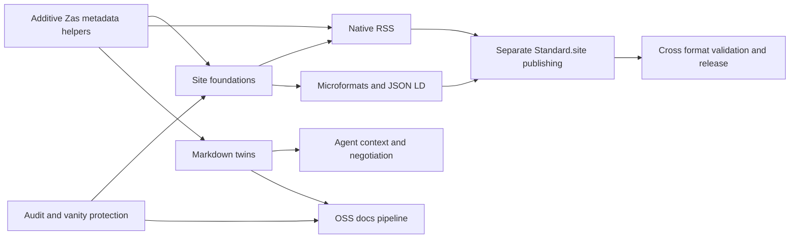

<!--
publish: false
-->

# Site implementation plan

Organize the October 2026 review into 33 independently reviewable tasks across this site and Zas. Protect Go import resolution first, build the metadata foundations next, and publish Standard.site records last. Every task has a dedicated subagent review, dependencies, commit boundaries, acceptance checks and rollback instructions.

[Decisions](DECISIONS.md) records D1–D17. [Audit facts](../HANDOFF-FACTS.md) contains timestamped live and repository evidence. [Progress](PROGRESS.md) records actual commits, PRs and remaining work; a completed review does not mean an implemented task.

## Repository boundaries

Site content, templates, hosting integration and site-specific tools belong here. Generic dates, listing, feeds and Markdown generation belong in Zas behind additive APIs or opt-in settings. Start independent Zas branches from current upstream master; stack a dependent PR on its prerequisite when shared code needs integration. Include tests and docs with their implementation, validate staging with darna, and open a focused PR for each item or independent part. Merge dependencies before enabling them here, then pin a tested release or commit in both the Makefile and CI. Do not pin @latest for production.

The report also asks for source-owned Mergo and darna docs and workflows. Their repositories are outside the two checkouts named in this request. Track the required source changes under T03, T24 and T25 and prepare local artifacts where useful; do not claim those repositories changed or that source-owned docs are complete until the external follow-up lands.

Your existing untracked docs/go-vanity-url.md is excluded from this work and from staging. Planning and operational Markdown files carry publish: false and must remain absent from generated output. Do not put Go template delimiters in those files: excluded pages are still parsed during generation.

## Corrected audit assumptions

- Unknown live resource URLs return a homepage fallback with 200 text/html. Feeds, well-known files and agent surfaces must pass content, MIME and path-specific checks, not just status checks.
- Seven raw vanity routes exist: mergo, darna, cocoon, errors, xdr, awaken and x. Their exact go-import values are the fixture; no go-source tags currently exist. lyd is prose. Preserve the imdario/mergo repository URL unless a separate reviewed change deliberately updates it.
- There is no tracked site deployment workflow. The existing Worker serves WebFinger and has no static-assets binding. The owner confirmed Cloudflare Pages Git integration on pushes to main, build command make -f .zas/Makefile publish, output .zas/deploy and blank root directory. This already uses the guarded build path. Plan static _headers and Pages middleware; function/Worker routing remains unverified. Publishing must follow a real successful Pages deployment, not an invented GitHub build workflow.
- The audited source already had h-card and rel=me links, and the layout emitted html lang. English and Spanish posts inherited ca at baseline; T04 now fixes the source defaults. Complete the identity markup rather than starting from an assumed absence.
- The posts already contain date_created. There are 33 public candidates and one draft; three candidates need time/offset precision handling. The report’s February Synology date is illustrative; the source contains an August timestamp.
- A duplicate en key in .zas/i18n.yml prevents a clean build with current Zas. Correct it in a separate prerequisite commit before enforcing build checks. Current upstream also rejects head-only vanity fragments before copying. Use isolated generator input excluding those fragments, restore exact bytes, then validate assembled output before promotion.

## Execution order and gates

The roadmap remains production first. Independent generator work can proceed while account settings are handled, but changes to the live site require an assembled-output vanity check. T00 is the entry point; T01 has independently verifiable account settings and monitoring work. T02 supplies the shared local and live checker used by monitoring and eventual deployment.

| Phase | Tasks | Exit evidence |
| --- | --- | --- |
| 0 Protect production | T00–T03 | Facts recorded; exact local/live vanity checks pass; registrar/DNS/external alert evidence recorded |
| 1 Foundations | T04–T10 | Sourced dates and language defaults; additive helpers merged; canonical/OG/contact/nav/security/sitemap checks pass |
| 2 RSS | T11–T13 | Deterministic RSS validates; discovery and real HTTP types/cache headers pass |
| 3 Microformats | T14–T18 | Representative h-card, actual post h-entry and archives parse; supported talk/project/slash types validated |
| 4 Agent surfaces | T19–T23 | JSON-LD, Markdown twins and context links agree; q-aware negotiation and AI policy pass; optional search selected or deferred |
| 5 OSS docs | T24–T25 | Pinned source docs render without plugins, exact vanity metadata remains, project context links are real |
| 6 Standard.site | T26–T30 | Publication verified; approved records match offline state; second run has zero writes; publish failure cannot block deploy |
| Wrap | T31–T32 | Cross-format tests and live definition of done pass; tested Zas release pinned and maintenance documented |

## Task index

Dependencies below include the report’s original ordering and repository-specific additions from each review. The detailed task pages explain optional dependencies and independent parts such as registrar work in T01 and generator-only work in T11.

| Task | Work | Repository | Depends on | Current status |
| --- | --- | --- | --- | --- |
| [T00](tasks/T00.md) | Verify unverified facts | site | — | Audit committed |
| [T01](tasks/T01.md) | Harden domain and DNS and add monitoring | site | T02 | Software committed; account operations pending |
| [T02](tasks/T02.md) | Protect vanity imports with regression checks | site | T00 | Guarded build and exact-SHA post-deploy workflow deployed and live-verified |
| [T03](tasks/T03.md) | Correct project identity links | zas | — | Zas PR #111 merged; external follow-up queued |
| [T04](tasks/T04.md) | Add explicit publication metadata to posts | site | T00, T02 | Source committed; three incomplete dates excluded from syndication |
| [T05](tasks/T05.md) | Expose dates and metadata in Zas templates | zas | — | Zas PR #112 merged; site pins tested merged revision |
| [T06](tasks/T06.md) | List pages in Zas templates | zas | T05 | Optional and deferred |
| [T07](tasks/T07.md) | Correct canonical and Open Graph metadata | site | T05, T04 | Deployed; canonical/OG/language checks pass |
| [T08](tasks/T08.md) | Publish contact details and self-host the avatar | site | — | Avatar/licence/contact deployed; readable cc@dario.cat edge checks pass |
| [T09](tasks/T09.md) | Add navigation and core slash pages | site | T07 | Core pages deployed; axe/keyboard/reflow/no-JS pass; Tier 2 remains queued |
| [T10](tasks/T10.md) | Publish crawler policy and security contact | site+zas | T00, T08, T04, T05, T07 | Policy/security/sitemap deployed; live resource and coverage checks pass |
| [T11](tasks/T11.md) | Generate native RSS 2.0 feeds | zas | T05 | [Zas PR #114](https://github.com/darccio/zas/pull/114) merged; enabled/deployed; all three live feeds validated |
| [T12](tasks/T12.md) | Expose feeds in the layout and slash index | site | T09, T11, T04 | Strict RSS, discovery and subscription page deployed and live-verified |
| [T13](tasks/T13.md) | Serve correct feed and well-known headers | site | T00, T11, T12 | Static Pages response rules deployed; live MIME/cache/policy checks pass |
| [T14](tasks/T14.md) | Complete representative identity microformats | site | T08, T09 | Deployed; live representative parser and existing Mastodon verification pass |
| [T15](tasks/T15.md) | Wrap posts in h-entry markup | site | T04, T05, T07, T14 | Deployed; 33 entries validated; narrow historical-email follow-up committed |
| [T16](tasks/T16.md) | Add h-feed archives and language labels | site | T04 | Deployed; complete 33/9/12 archives pass live checks |
| [T17](tasks/T17.md) | Mark up talks and other supported page types | site | T09, T14 | Talk/slash/project units deployed and live-verified; CV deferred |
| [T18](tasks/T18.md) | Validate microformats in CI | site | T14, T15, T16, T02, T04 | Deployed; offline fixtures, staged Pages validation and CI pass |
| [T19](tasks/T19.md) | Emit shared JSON-LD metadata | site+zas | T05, T14, T15, T07, T08, T24 | Planned |
| [T20](tasks/T20.md) | Publish per-language agent context files | site | T09, T21 | Planned |
| [T21](tasks/T21.md) | Generate Markdown twins in Zas | zas | T05 | [Zas PR #113](https://github.com/darccio/zas/pull/113) merged; twins and inventory discovery enabled |
| [T22](tasks/T22.md) | Negotiate Markdown at the actual site host | site | T00, T21, T13, T02, T10 | Negotiation queued; matching static Content-Signal header deployed |
| [T23](tasks/T23.md) | Add optional declarative search tooling | site | T06 | Optional and deferred |
| [T24](tasks/T24.md) | Pull and host OSS docs safely | site+zas | T02, T21, T10 | Planned |
| [T25](tasks/T25.md) | Write and test Mergo guides | site preparation; external source follow-up | T24 | Planned |
| [T26](tasks/T26.md) | Bootstrap Standard.site publication | site | T00, T13, T10 | Planned |
| [T27](tasks/T27.md) | Publish documents with stable record keys | site | T04, T26 | Planned |
| [T28](tasks/T28.md) | Link verified Standard.site documents | site | T27, T02 | Planned |
| [T29](tasks/T29.md) | Separate publishing from site deployment | site | T27, T28, T00 | Planned |
| [T30](tasks/T30.md) | Backfill approved posts | site | T29, T27, T28 | Planned |
| [T31](tasks/T31.md) | Verify agreement across publishing formats | site | T11, T15, T19, T27 | Planned |
| [T32](tasks/T32.md) | Document and release the finished features | site+zas | T05, T11, T21, T29, T02, T31 | Planned |

## Secondary work and maintenance

T09 includes the Tier 2 slash-page backlog as separate content commits: /elsewhere, /uses, /defaults, /changelog, /blogroll, /sponsor and /languages. T17 covers richer talks markup and the proposed /cv/ render, with the existing CV processing restriction resolved first. Use real public dates/venues/roles and owner-supplied current activity or tooling. /hello/ can alias /contact/ while existing /contact.html remains reachable.

Keep optional T06 listing, T23 WebMCP search, Pagefind and any justified client JavaScript deferred until explicitly selected. Skip Webmentions, novelty pages, parallel feed formats and a speculative WebMCP manifest. Revisit a Catalan-only feed only on demand. Preserve funding.json, public machine-readable CV and existing feed/archive/post/import URLs.

Maintenance belongs with the feature that introduces it: T01 domain and monitor reviews; T09 dated /now reminders; T10 security.txt expiry renewal; T24 docs rebuild triggers and source revisions; T29 weekly schema dry-run plus periodic secret/account checks. T32 documents these routines and final live checks.

## Rules for implementation

1. Dispatch the task’s implementation subagent once its dependencies are satisfied; give it explicit file ownership and an isolated Zas branch. Reviews for all 33 items are already assigned separately.
2. Preserve every existing vanity tuple and import route after each build. Build pulled docs with zas generate -full -no-plugins. Test GOPROXY=direct module resolution in an isolated module/cache; it is a live integration check, not a substitute for the exact HTML fixture.
3. Preserve Catalan root content, explicit English/Spanish language roots and trailing-slash post URLs. Never invent publish dates, personal activity, locality or unsupported microformats properties.
4. Stage only the smallest complete task unit. Run darna --committable --dependants, inspect its suggestion, preserve unrelated files, review staged diff, run darna and relevant checks, and respect hooks. Each Zas unit gets a PR; do not merge or tag releases merely to unblock a site change without passing required checks.
5. Prepare concrete reviewed artifacts before account actions. Secrets stay in account settings. Do not overwrite the WebFinger Worker. Standard.site dry-run is the default; approved allowlists and real verification URIs precede publication.
6. Record commit SHA, PR URL, tests and actual limits in PROGRESS.md. Only mark an implementation complete when all acceptance evidence exists; distinguish local build checks, live checks and owner settings. Site deployment must work with the PDS unreachable.

## Final live acceptance

Verify renewal/lock/DNSSEC and external alerts; every vanity path before and after deployment; accessible navigation and all maintained slash URLs; correct canonical/OG/contact/licensing; each feed with a real XML validator and two byte-identical builds; h-card/rel=me/Mastodon and all mf2 types; valid JSON-LD and real Markdown/context links; q-aware negotiation and matching crawler/header policy; source-owned project docs; approved Standard.site record counts and zero-write rerun; offline cross-format tests; a tested released generator pin. Deferred optional features and incomplete owner operations remain visible in PROGRESS.md.
